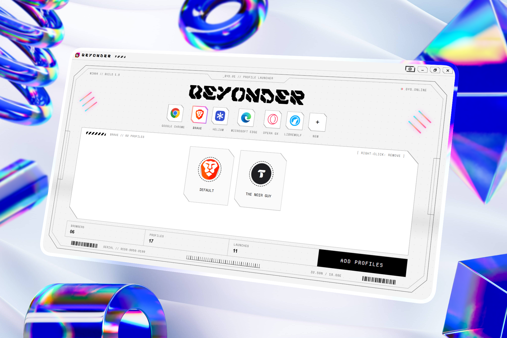
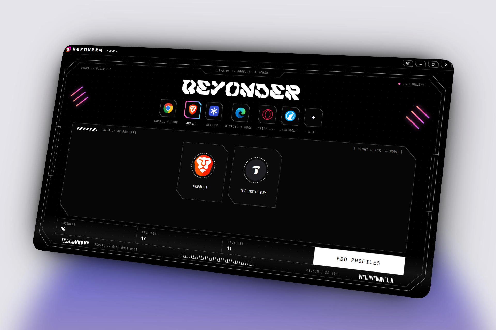
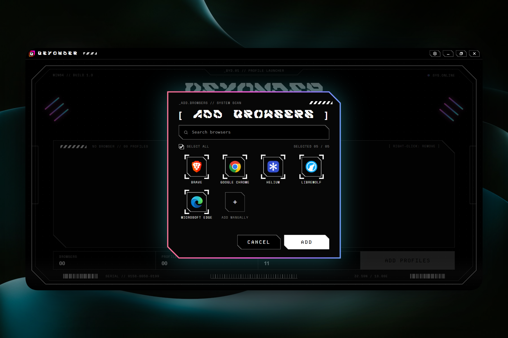
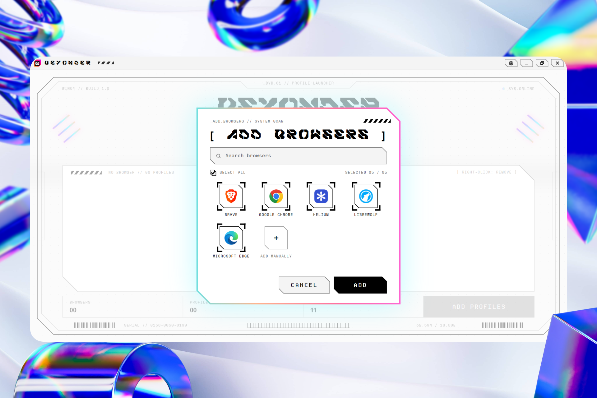
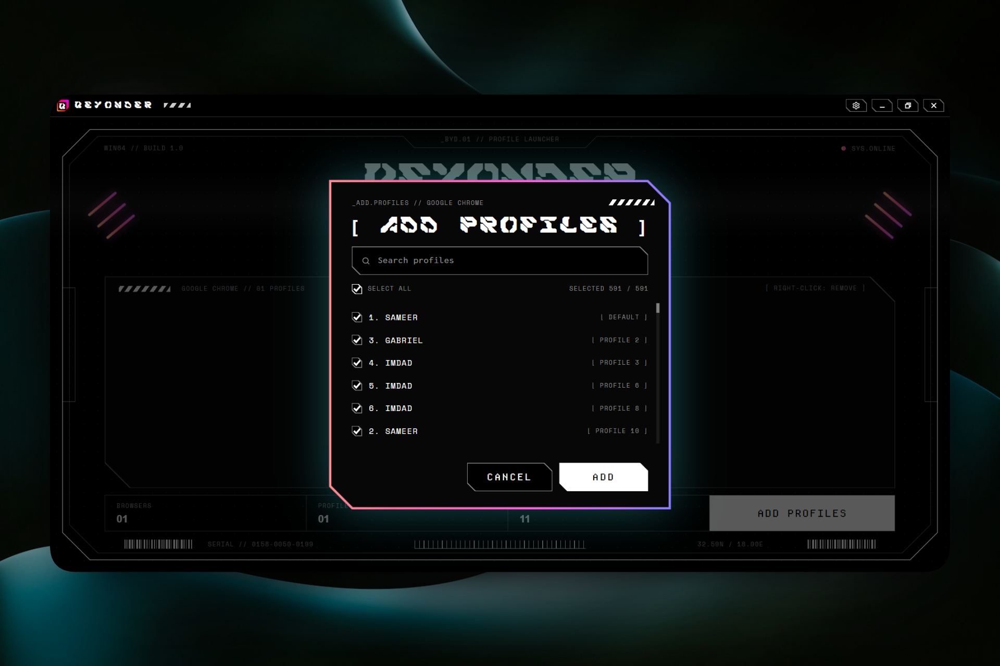
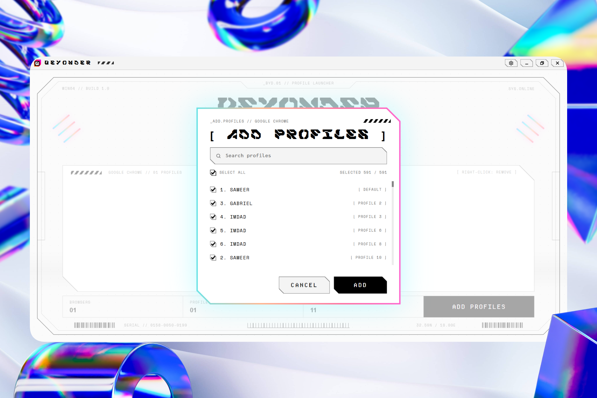
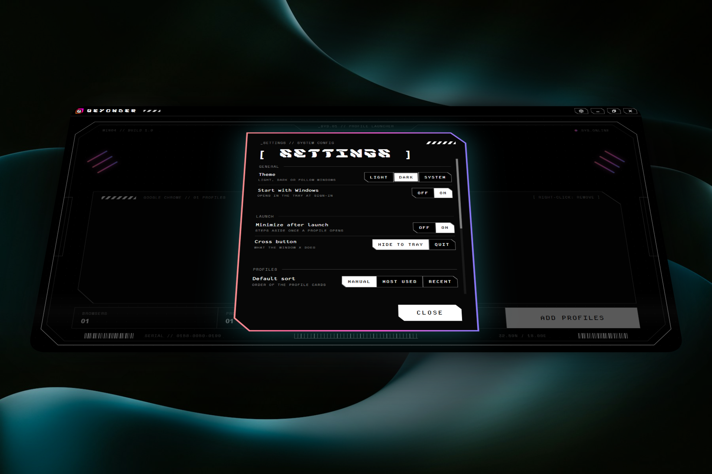
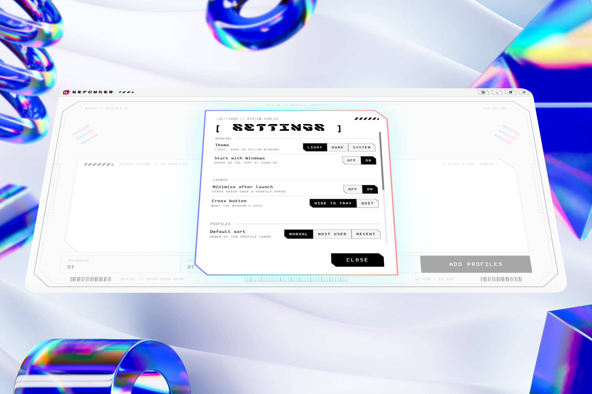

# Beyonder

**A fast, good-looking browser and profile launcher for Windows.**

Beyonder finds the browsers installed on your PC by itself and gives every browser profile its own one-click card.


[](assets/screenshots/light1.png)
[](assets/screenshots/dark1.png)

<details>
<summary><b>More screenshots</b></summary>

<br>

<table>
  <tr>
    <td align="center"><b>Dark Mode</b></td>
    <td align="center"><b>Light Mode</b></td>
  </tr>
  <tr>
    <td></td>
    <td></td>
  </tr>
  <tr>
    <td></td>
    <td></td>
  </tr>
  <tr>
    <td></td>
    <td></td>
  </tr>
</table>

</details>

## Highlights

- **Automatic browser discovery.** Scans the same list Windows uses for Default apps, plus the usual install folders.
- **One card per profile.** Chromium, Firefox family and Opera GX profiles are read straight from the browser, with real names and pictures.
- **Read-only and safe.** Beyonder never deletes or changes anything inside a browser's own data. Remove is always undoable.
- **Native window, web interface.** A pywebview window (WebView2) with an HTML/CSS/JS interface and Python logic behind it.
- **Lives in your tray.** Start with Windows, a global hotkey, and your 5 most recent profiles one click away.
- **Light, Dark or System theme**, drag-to-reorder, launch statistics, and one-click backup and restore.

## Download

Get the latest version here: **[Beyonder-Windows.zip](https://github.com/the-noir-guy/beyonder/releases/latest/download/Beyonder-Windows.zip)**

Unzip it and run `Beyonder.exe`. No Python needed. All versions are on the [Releases page](https://github.com/the-noir-guy/beyonder/releases).

> [!NOTE]
> The `.exe` is not code-signed, so Windows SmartScreen may show a warning the first time. Choose **More info**, then **Run anyway**.

## Run from source

1. Install **Python 3.9 or newer** for Windows (64-bit) and the **Microsoft Edge WebView2 Runtime** (already present on Windows 11 and most Windows 10 PCs).
2. Double-click `beyonder.pyw`.
3. On the first run the app installs `pywebview`, `Pillow` and `pystray` by itself. This needs internet and takes a short while before the window appears. If it fails, run:

   ```
   pip install pywebview Pillow pystray
   ```

If WebView2 is missing, a message box shows the download link.

## Documentation

- [DOCS.md](DOCS.md) — Complete Manual & Instructions of Beyonder
- Too lazy to make a proper docs folder ^_^

## Feedback

Found a bug or want a feature? Please [open an issue](https://github.com/the-noir-guy/beyonder/issues) and tell me what you did, what you expected, and what happened instead. The last lines of `data/error.log` and a screenshot help a lot. If your favorite browser is missing, just tell me its name.

If Beyonder saves you some clicks, a ⭐ on the repo is a lovely way to say thanks.

## Find me

- Email: [thenoirguy.me@gmail.com](mailto:thenoirguy.me@gmail.com)
- Facebook: [The Noir Guy](https://www.facebook.com/profile.php?id=61596567771708)
- Instagram: [@the_noir.guy](https://www.instagram.com/the_noir.guy/)
- Twitter/X: [@the_noir_guy](https://x.com/the_noir_guy)
- Discord: [The_Noir_Guy](https://discord.com/users/1569354601386479647)

## License

[PolyForm Noncommercial License 1.0.0](https://polyformproject.org/licenses/noncommercial/1.0.0). Free for personal, hobby, research, and non-commercial use. Commercial use is **not allowed** without a separate license from the author. See [LICENSE.md](LICENSE.md).
- Free for personal, hobby, research, and non-commercial use.
- Commercial use is **not allowed** without a separate license from the author.
